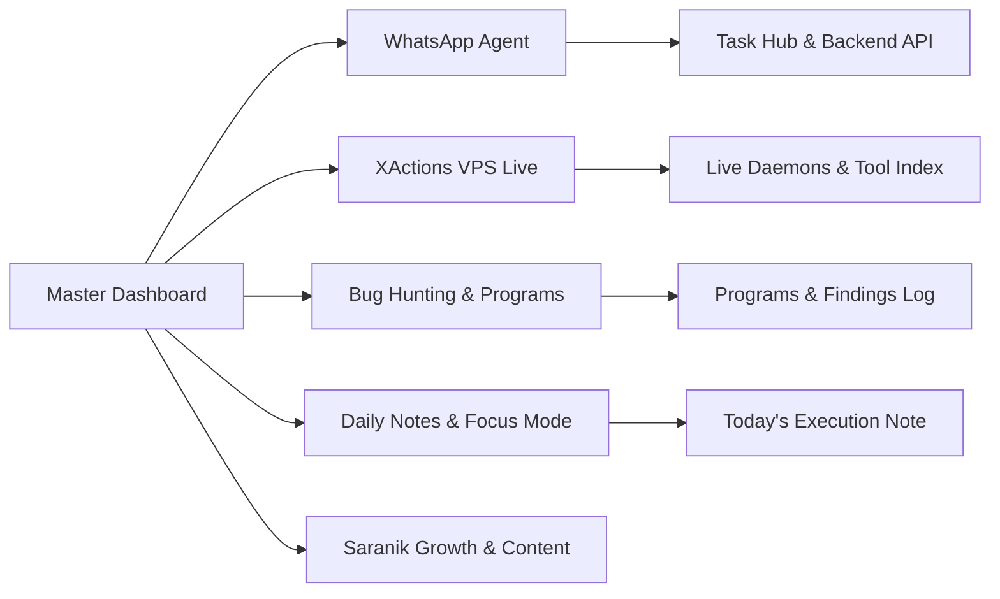

# 🌌 Master Command Center

> **System Philosophy:** *Work on exactly ONE task at a time with 100% focus. Track all active systems, verify continuously, and close loops daily.*

---

## ⚡ Active Single-Task Execution Focus

> [!IMPORTANT]
> **Currently Active Task:** [[01 - Focus Mode (One Task)|👉 Jump directly to Focus Mode]]
> *Rule: Do not switch tasks until the current one is either marked `DONE` or cleanly paused with state saved.*

| Focus Area | Task Name | Status | Branch / Path | Priority |
| :--- | :--- | :--- | :--- | :--- |
| **WhatsApp Agent** | Server-side `/agent/logs` & `/leads` filtering | 🟡 In Progress | `whatsapp_agent/` | P0 |
| **XActions VPS** | Proxy rotation & health monitor check | 🟢 Stable / Polling | `xactions-vps-live/` | P1 |
| **Bug Hunting** | Target Recon & Subdomain Takeover Sweep | 🔵 Next Up | `telenor/`, `tesla/` | P0 |
| **Saranik Growth** | Fill founder gaps → unlock 5 blogs + 4 threads · daily manual replies | 🟢 Live (daily 06:00 / 11:00) | [[06 - Saranik Growth & Content/Saranik Growth - Master Hub\|Growth Hub]] | P1 |

---

## 🧭 Quick Navigation Hub



### 📱 1. WhatsApp Agent Ecosystem
- 📋 **Tasks & Pipeline:** [[01 - WhatsApp Agent/WhatsApp Agent - Master Task Hub|WhatsApp Agent Task Hub]]
- 🏗️ **Architecture & Spec:** [[01 - WhatsApp Agent/WhatsApp Agent - Architecture & System Spec|System Architecture & DB Models]]
- ⚙️ **Backend & API:** [[01 - WhatsApp Agent/WhatsApp Agent - Backend & API Roadmap|FastAPI & Supabase Roadmap]]
- 🖥️ **Console & Frontend:** [[01 - WhatsApp Agent/WhatsApp Agent - Console & UI Tasks|Next.js Dashboard Tasks]]
- 🚀 **Ops & Deploy:** [[01 - WhatsApp Agent/WhatsApp Agent - Deployment & Operations|Service Control & Shell Scripts]]

### ⚡ 2. XActions VPS Live Suite
- 📋 **Master Hub:** [[02 - XActions VPS Live/XActions - Master Task Hub|XActions Live Task Hub]]
- 🧩 **Module Directory:** [[02 - XActions VPS Live/XActions - Architecture & Module Index|340+ Automated Scripts & Index]]
- 🤖 **VPS Daemons & Cron:** [[02 - XActions VPS Live/XActions - VPS Daemons & Cron Jobs|Live Process & Health Monitor]]
- 🛠️ **Roadmap & Upgrades:** [[02 - XActions VPS Live/XActions - Tool Backlog & Upgrades|Rate Limits, Anti-Bot & Upgrades]]

### 🎯 3. Daily Bug Hunting & Security Programs
- 🛡️ **Hunting Dashboard:** [[03 - Bug Hunting & Security/Bug Hunting - Master Dashboard|Bounty Target Pipeline & Metrics]]
- 🏆 **Findings Log:** [[03 - Bug Hunting & Security/Findings Log|Vulnerability Tracker & Submissions]]
- 🏢 **Active Targets:**
  - [[03 - Bug Hunting & Security/Programs/Telenor|Telenor Program]]
  - [[03 - Bug Hunting & Security/Programs/Tesla|Tesla Program]]
  - [[03 - Bug Hunting & Security/Programs/Saranik|Saranik Platform]]
  - [[03 - Bug Hunting & Security/Programs/CGO & Dirk & Grawe|CGO / Dirk / Grawe / Mercedes]]
  - [[03 - Bug Hunting & Security/Programs/VDP & CERT-In Programs|VDPs / DoD / CERT-In / YesWeHack]]
- 🔍 **Methodology & Checklists:**
  - [[03 - Bug Hunting & Security/Methodology & Checklists/Recon & Asset Discovery|Recon & Asset Discovery]]
  - [[03 - Bug Hunting & Security/Methodology & Checklists/API & IDOR Checklist|API & IDOR Hunting Checklist]]
  - [[03 - Bug Hunting & Security/Methodology & Checklists/Auth & Privilege Escalation|Auth & BAC Testing]]

### 📅 4. Daily Execution & Journaling
- 📝 **Today's Daily Note:** [[04 - Daily Notes/2026-09-26|Daily Note - 2026-09-26]]
- 🎯 **Single Task Focus Page:** [[00 - Dashboard & Focus/01 - Focus Mode (One Task)|One Task At A Time Workspace]]
- 📑 **Daily Template:** [[05 - Templates/Daily Note Template|Standard Daily Note Template]]

---

## 📊 Live System Metrics & Status Check

```
[SYSTEM STATUS CHECK]
├─ WhatsApp Agent: 🟢 API & Baileys Runner (Port 8000 / 3000)
├─ XActions VPS:   🟢 340+ Modules, Auto-Campaigns & Monitor Online
├─ Bug Hunting:    🟡 5 Programs in Active Recon & Fuzzing
└─ Work Rhythm:    🎯 Single Task Lock Mode: Active
```

---

## 📌 Rules of Daily Execution
1. **Never Multitask in Code:** Keep one IDE window / one terminal session dedicated to the single active task.
2. **Commit / Log Every Milestone:** Update your daily note whenever an endpoint is fixed, a scraper is deployed, or a bug is reported.
3. **Capture Before You Forget:** Dump all random thoughts, bug hypotheses, and tool ideas into the **Inbox / Scratchpad** on the Focus Page.
