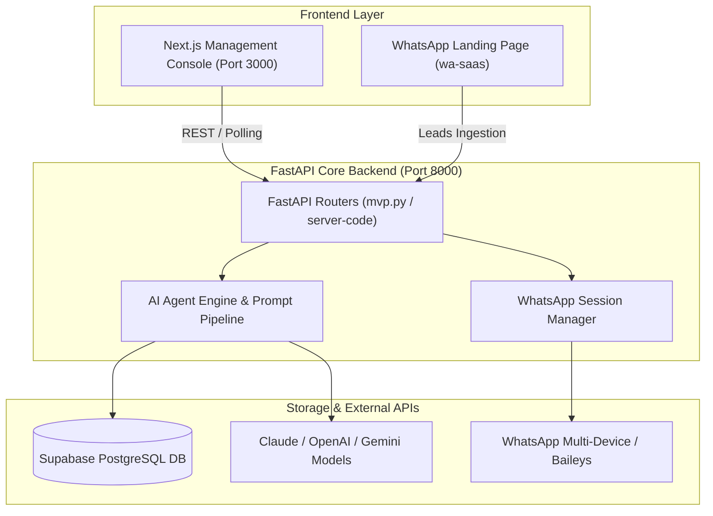

# 🏗️ WhatsApp Agent — Architecture & System Spec

> **Codebase Path:** `/Users/garvsanwariya/bounty/whatsapp_agent/`  
> **Key References:** `DASHBOARD_SPEC.md`, `08-supabase-schema.md`, `server-code/`

---

## 📐 System Architecture Diagram

---

## 🗄️ Core Database Models & Schemas

### 1. Workspaces & Auth
- **Workspace:** Multi-tenant container holding company info, settings, message limits, and token budgets.
- **Session:** QR code state, connection status (`CONNECTED`, `QR_READY`, `DISCONNECTED`), updated timestamp.

### 2. Leads & CRM Pipeline
- `id`: UUID Primary Key
- `workspace_id`: Multi-tenant reference
- `sender` / `jid`: Customer WhatsApp JID (e.g. `1234567890@s.whatsapp.net`)
- `name`: Contact display name
- `status`: `NEW` -> `CONTACTED` -> `QUALIFIED` -> `MEETING_SCHEDULED` -> `CONVERTED` -> `LOST`
- `source_group_name`: Origin WhatsApp community group
- `needs_response`: Boolean flag for immediate follow-up
- `human_takeover`: Boolean toggle disabling auto-AI replies for this contact

### 3. Logs & Events
- `event_type`: `agent_step`, `group_message_skipped`, `lead_detected`, `message_sent`, `draft_created`
- `title` & `detail`: Human-readable summary
- `group_jid` & `lead_id`: References for deep-linking

---

## 🔗 Related Notes
- [[01 - WhatsApp Agent/WhatsApp Agent - Master Task Hub|WhatsApp Agent Task Board]]
- [[01 - WhatsApp Agent/WhatsApp Agent - Backend & API Roadmap|Backend Roadmap & Schema Alignment]]
- [[01 - WhatsApp Agent/WhatsApp Agent - Console & UI Tasks|Console Implementation Details]]
