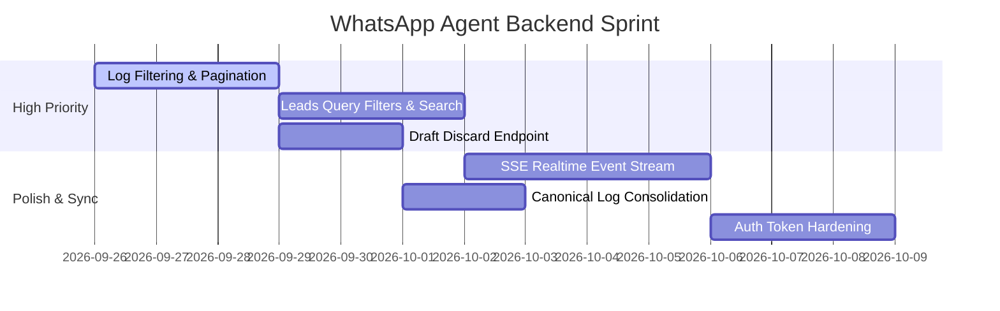

# ⚙️ WhatsApp Agent — Backend & API Roadmap

> **Source Tracking:** `whatsapp_agent/TODO-BACKEND.md`  
> **Server Engine:** FastAPI / Python 3.11 / Uvicorn

---

## 🎯 Backend Feature Tracker & Milestones



---

## 🔍 Specific API Work Packages

### 1. `/agent/logs` Pagination & Query Refactor
- **Current Issue:** Endpoint returns all unpaginated records, dumping 13k+ `group_message_skipped` noise items.
- **Solution:** Add query schema:
  ```python
  @app.get("/agent/logs")
  async def get_agent_logs(
      event_type: Optional[str] = None,
      exclude: Optional[str] = "group_message_skipped",
      limit: int = 50,
      cursor: Optional[str] = None
  ): ...
  ```
- **Tests:** Verify with large datasets; ensure cursor navigation works forward and backward.

### 2. `/leads` Advanced Filters
- **Parameters to Implement:**
  - `status`: Filter by pipeline stage (`new`, `contacted`, `qualified`, etc.)
  - `needs_response`: True / False filter
  - `human_takeover`: Boolean toggle
  - `q`: Search across name, phone/jid, and message text
  - `sort`: `created_at:desc`, `last_inbound_at:desc`
- **Output:** Paginated JSON envelope `{ok: true, leads: [...], next_cursor: "..."}`.

### 3. Draft Lifecycle Improvements
- [x] Added read-only `GET /api/drafts`
- [ ] Add `POST /api/drafts/{id}/discard` (soft-delete / status `DISCARDED`)
- [ ] Add `POST /api/drafts/{id}/approve` (triggers immediate WhatsApp outbound queue)

---

## 🔗 Quick Links
- [[01 - WhatsApp Agent/WhatsApp Agent - Master Task Hub|Back to Master Task Hub]]
- [[01 - WhatsApp Agent/WhatsApp Agent - Console & UI Tasks|Console Implementation Guide]]
