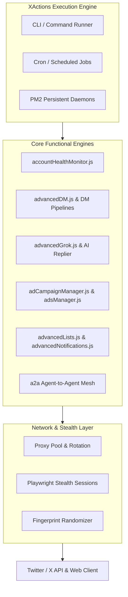

# 🧩 XActions — Architecture & Module Index

> **Directory:** `/Users/garvsanwariya/bounty/xactions-vps-live/`  
> **Total Tools:** 340+ JavaScript & Node.js automation modules

---

## 🏛️ System Architecture

---

## 📂 Primary Script Directory

| Module File | Purpose & Responsibilities | Key Flags / Commands |
| :--- | :--- | :--- |
| `accountHealthMonitor.js` | Evaluates shadowban status, rate limits, cookie health | `node accountHealthMonitor.js` |
| `advancedDM.js` | Bulk personalized outreach, follow-up sequencing | `node advancedDM.js --campaign test` |
| `advancedGrok.js` | Contextual AI summarization and autonomous replies | `node advancedGrok.js --reply` |
| `adCampaignManager.js` | Manages Twitter Ads campaigns, budget & spend | `node adCampaignManager.js` |
| `advancedCreator.js` | Analytics for creator monetization, views, impressions | `node advancedCreator.js` |
| `advancedLists.js` | Automated list scraping, curating, and member sync | `node advancedLists.js` |
| `advancedNotifications.js` | Priority notification parser & action trigger | `node advancedNotifications.js` |
| `accountMisc.js` | Account settings, bio sync, profile picture rotation | `node accountMisc.js` |

---

## 🔗 Related Notes
- [[02 - XActions VPS Live/XActions - Master Task Hub|XActions Task Hub]]
- [[02 - XActions VPS Live/XActions - VPS Daemons & Cron Jobs|VPS Daemons & Cron Execution]]
