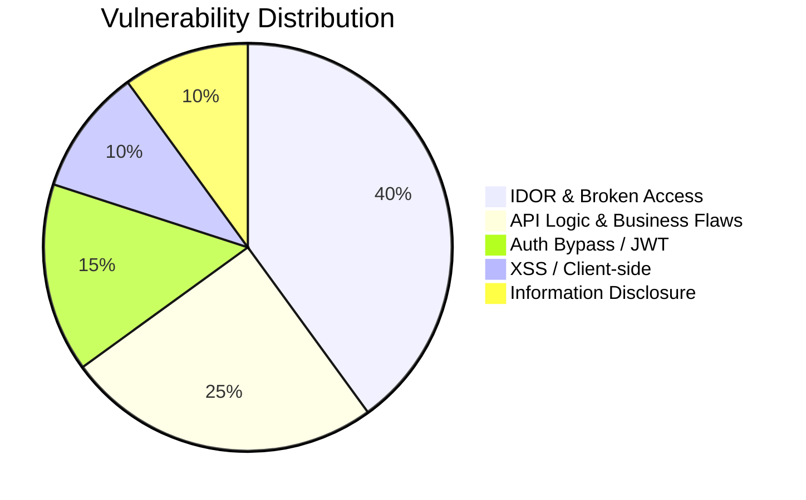

# 🛡️ Bug Hunting — Master Command Center

> **Methodology:** Depth over breadth. Pick ONE target program, map attack surface completely, test every parameter, and document proof-of-concepts systematically.

---

## 🎯 Active Bug Bounty Target Pipeline

| Target Program | Platform | Bounty Status | Focus Area | Notes / Status |
| :--- | :--- | :--- | :--- | :--- |
| [[03 - Bug Hunting & Security/Programs/Telenor\|Telenor]] | Bugcrowd / H1 | 💰 Paid Bounty | Subdomains & Core APIs | 🟡 Active Recon (`targets.txt`) |
| [[03 - Bug Hunting & Security/Programs/Tesla\|Tesla]] | Bugcrowd | 💰 Paid Bounty | Gateway & IoT Endpoints | 🟡 In Scope (`tesla/`) |
| [[03 - Bug Hunting & Security/Programs/Saranik\|Saranik]] | Private / BBP | 💰 Paid Bounty | Full App Logic & Auth | 🟢 Primary (`saranik/`) |
| [[03 - Bug Hunting & Security/Programs/CGO & Dirk & Grawe\|CGO / Dirk / Grawe]] | Private Targets | 💰 Paid Bounty | ERP / Web Portals | 🔵 Pipeline Ready |
| [[03 - Bug Hunting & Security/Programs/VDP & CERT-In Programs\|VDP & CERT-In]] | Government / VDP | 🎖️ HoF / Badges | Critical Infra & VDPs | 🟢 Continuous Sweep |

---

## 📊 Summary of Vulnerability Findings

> 🏆 **Complete Log:** [[03 - Bug Hunting & Security/Findings Log|View Full Findings Log & Report Submissions]]



---

## 🧰 Daily Hunting Toolkit & Workspaces
- **Recon & Nuclei:** `final_freaking_nuclei_templates/`, `Custom_Vuln_Scan_Templates/`
- **Fuzzing & Parameters:** `GooFuzz/`, `LinkFinder/`, `secretfinder/`
- **AI Hunting Agents:** `Claude-BugHunter/`, `burp-ai-agent/`, `DorkAgent/`
- **Interception Proxy:** Caido (`caido/`) & Burp Suite (`burp-ai-agent/`)

---

## 🔍 Hunting Methodology & Checklists
1. 🌐 [[03 - Bug Hunting & Security/Methodology & Checklists/Recon & Asset Discovery|Recon & Asset Discovery Checklist]]
2. 🔑 [[03 - Bug Hunting & Security/Methodology & Checklists/API & IDOR Checklist|API & IDOR Testing Playbook]]
3. 🚪 [[03 - Bug Hunting & Security/Methodology & Checklists/Auth & Privilege Escalation|Authentication & Authorization Flaws]]

---

## ⚡ Fast CLI Recon Commands
```bash
# Resolve subdomains with httpx
cat targets.txt | httpx -sc -title -td -cl -o live_targets.txt

# Run Nuclei with focused severity
nuclei -l live_targets.txt -t Custom_Vuln_Scan_Templates/ -severity critical,high,medium -o nuclei_results.txt

# Extract JavaScript endpoints with LinkFinder
python3 LinkFinder/linkfinder.py -i https://target.com/app.js -o cli
```
