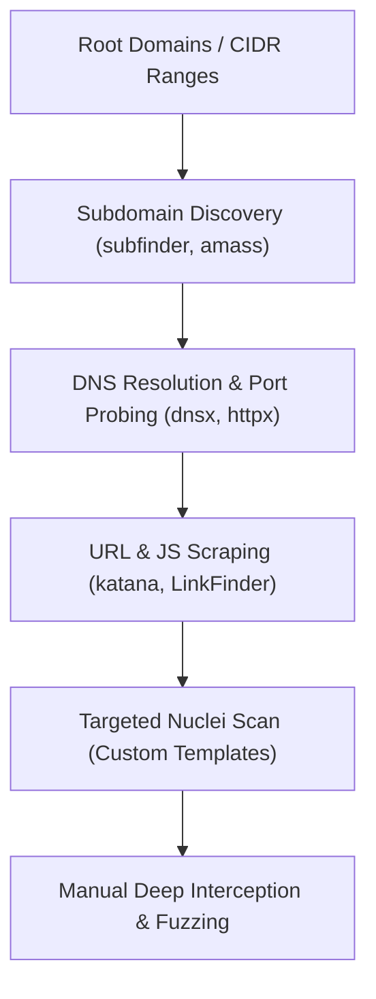

# 🌐 Methodology: Recon & Asset Discovery

> **Goal:** Build the complete attack surface before firing single exploit payloads.

---

## 🧭 Step-by-Step Recon Workflow



---

## 🛠️ Essential Recon Commands
```bash
# 1. Passive & Active Subdomain Enumeration
subfinder -d target.com -all -silent | tee -a subdomains.txt

# 2. Live HTTP/HTTPS Probing
cat subdomains.txt | httpx -sc -title -tech-detect -cl -mc 200,301,302,403,401 -o live_hosts.txt

# 3. Parameter and Endpoint Crawling
katana -list live_hosts.txt -jc -d 3 -o katana_endpoints.txt

# 4. Hidden JS Endpoints & Secret Extraction
python3 secretfinder/SecretFinder.py -i https://target.com/main.js -o cli
```

---

## 🔗 Quick Links
- [[03 - Bug Hunting & Security/Bug Hunting - Master Dashboard|Back to Dashboard]]
- [[03 - Bug Hunting & Security/Methodology & Checklists/API & IDOR Checklist|API & IDOR Testing]]
