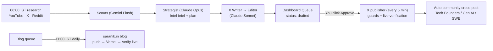

# 🚀 Saranik Growth & Content — Master Hub

> **Goal:** Grow @GarvSanwariya on X and win clients for **saranik.in** (WhatsApp AI agents, AI automation, chatbots for Indian businesses) with an AI research → content → approval → publishing system.
> **Harness:** Antigravity CLI (`agy`) — Gemini Flash for research, Claude Sonnet/Opus for writing & strategy.
> **Rule:** every X post needs owner approval. Blogs publish from a vetted queue. No automated replies/likes.

---

## 🧭 System Map



---

## 🗂️ Notes in this section
1. 📜 [[06 - Saranik Growth & Content/Session Log 2026-09-28 → 10-01|Session log — everything built & changed]]
2. 🤖 [[06 - Saranik Growth & Content/VPS Crons, Services & Safety Rules|VPS crons, services, safety rules (current state)]]
3. 📅 [[06 - Saranik Growth & Content/Content Calendar & Idea Queue|Content calendar, idea queue & open questions]]
4. 🎬 [[06 - Saranik Growth & Content/Reel Ideas — AI Niche (24)|Reel ideas — AI niche (24)]]
5. 📈 [[06 - Saranik Growth & Content/X Growth & Client Playbook|X growth & client playbook]]
6. 🔎 [[06 - Saranik Growth & Content/Research — SuperX & Creator Playbooks|Research — SuperX & creator playbooks]]

---

## 📍 Where things live

| What | Mac | VPS |
| :--- | :--- | :--- |
| Growth Engine (agents, publishers) | `~/saranik-growth/` | `/home/adminhermes/saranik-growth/` |
| Plan | `~/.claude/plans/quiet-booping-umbrella.md` | — |
| Brand rules (voice, offers, proof, playbook) | `~/saranik-growth/brand/` | same |
| Post drafts & statuses (VPS owns these) | — | `saranik-growth/drafts/x/*.json` |
| Blog queue | `~/saranik-growth/blog-queue/` | same + `status.json` per post |
| Content drafts + images | `~/saranik-growth/content-drafts/` | — |
| Dashboard (Next.js `web/`) | `xactions-vps-live/web/` | `~/xactions/web` (pm2 `xa-web`) |
| saranik.in site repo | `~/bounty/saranik` | `~/saranik` (pushes → Vercel) |

**Dashboard:** `https://<VPS-IP>/xagent` — user `saranik`, password in `~/saranik-growth/.dashboard-password` (never paste it into notes).

---

## 💻 Fast Commands

```bash
# SSH
ssh -i ~/.ssh/hermes_vps -o IdentitiesOnly=yes adminhermes@<VPS-IP>

# Deploy code from Mac (never overwrites drafts/briefs/state on the VPS)
~/saranik-growth/deploy.sh

# On the VPS (inside ~/saranik-growth)
node run-daily.mjs --stage writers      # fetch | scouts | strategist | writers | notify
node publish/x.mjs --list               # X schedule + statuses
node publish/blog.mjs --list            # blog queue readiness
node publish/blog.mjs --dry             # validate next blog, publish nothing
tail -f logs/publish.log logs/blog.log logs/daily.log
```

---

## 🔗 Related
- [[02 - XActions VPS Live/XActions - Master Task Hub|XActions Task Hub]]
- [[00 - Dashboard & Focus/00 - Master Dashboard|Master Dashboard]]
